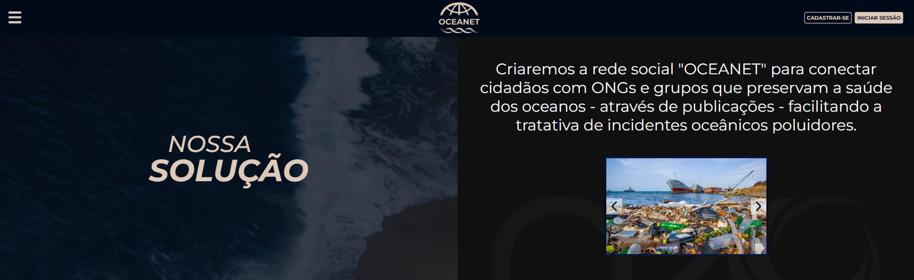

**[Site](https://z4ffarani-oceanet.vercel.app)**

A **[O20](https://www.g20.org/pt-br/g20-social/grupos-de-engajamento/oceans-20)**, em parceria com o projeto Blue Future da **[FIAP](https://www.fiap.com.br)**, procura soluções inovadoras utilizando as novas tecnologias para promover o futuro sustentável dos oceanos. Com isso, decidimos elaborar um protótipo de site para apresentar uma hipotética rede social que facilitará a comunicação entre cidadãos comuns e atuadores de preservação da saúde dos oceanos, reduzindo o lixo disperso nas regiões litorâneas e oceânicas.

---

## Integrantes

- [Guilherme Santos Nunes](https://github.com/sannunez)
- [Henry Evideira Paulo](https://github.com/Hep4xl0)
- [Kaique Zaffarani](https://github.com/Z4ffarani)

---

## Páginas

| Página | Conteúdo |
|---|---|
| **Home** | Página principal do site contendo os principais elementos visuais |
| **Registro** | Página dedicada ao registro do usuário |
| **Login** | Página dedicada ao login do usuário |

---

## Funcionalidades

- **Registro e login de usuários** | Formulário de cadastro que armazena os dados do usuário (nome, email e senha), validação de senha com feedback visual para garantir que as senhas coincidem e autenticação simples no Login, utilizando a comparação das credenciais fornecidas com aquelas armazenadas temporariamente no navegador.
- **Carrossel de imagens** | Apresentação visual de slides com a possibilidade de navegação para os lados.
- **Menu de gaveta** | Menu lateral deslizante que pode ser aberto e fechado, facilitando a navegação no site.

---

## Como executar

```bash
git clone https://github.com/Z4ffarani/Oceanet.git
cd Oceanet
```

Abra o arquivo `index.html` no navegador.

---

## Observações

- O projeto utiliza `sessionStorage` para armazenar dados temporariamente. Isso significa que os dados são mantidos apenas enquanto a aba do navegador estiver aberta, sendo perdidos ao fechar o navegador ou recarregar a página. Para um sistema mais robusto de login, recomenda-se o uso de um banco de dados e autenticação segura.
- A validação básica de formulários foi implementada para o cadastro de usuários, mas é recomendado aprimorar a segurança com validação no back-end e criptografia de senhas.
- A funcionalidade do carrossel de imagens está programada para transitar entre os slides com um simples efeito de translação `translateX`, ideal para sites estáticos. No entanto, é possível melhorar a experiência do usuário adicionando animações suaves e `autoplay`.
- O menu de gaveta pode ser melhorado para ter suporte a navegação mais complexa, como submenus ou integração com uma base de dados de páginas dinâmicas.
- Este projeto é apenas um protótipo voltado para testes e demonstrações. Em um ambiente de produção, recomenda-se o uso de tecnologias adicionais, como frameworks de front-end, além de um servidor back-end para gerenciar autenticação e armazenamento de dados de forma segura.

---

## Tecnologias

[](https://developer.mozilla.org/pt-BR/docs/Web/HTML)
[](https://developer.mozilla.org/pt-BR/docs/Web/CSS)
[](https://developer.mozilla.org/pt-BR/docs/Web/JavaScript)
[](https://vercel.com)

---

## Referências

| # | Referência | Aplicação no projeto |
|---|---|---|
| 1 | [Marinha do Brasil — Combate ao lixo no mar](https://www.marinha.mil.br/combate-ao-lixo-no-mar) | Contexto sobre o lixo disperso nas regiões litorâneas e oceânicas |
| 2 | [Como a poluição nos oceanos afeta nossa vida?](https://cestosdelixoelixeiras.com.br/blog-lixeiras/como-a-poluicao-nos-oceanos-afeta-nossa-vida) | Impactos da poluição oceânica que motivam a rede social |
| 3 | [Um Só Planeta — Poluição dos oceanos: quais são as consequências para o planeta](https://umsoplaneta.globo.com/biodiversidade/noticia/2021/06/19/poluicao-dos-oceanos-quais-sao-as-consequencias-para-o-planeta.ghtml) | Consequências ambientais usadas na proposta do projeto |
